<p align="center">
  
</p>

<p align="center">
  <a href="https://git.io/typing-svg"></a>
</p>

<p align="center">
  <a href="https://ksrinivasarao2012.github.io"></a>
  <a href="https://www.linkedin.com/in/kommanasrinivasarao/"></a>
  <a href="mailto:raokommanasrinivasa@gmail.com"></a>
  
</p>

---

## 🧠 About me

```python
class SrinivasaRao:
    degree     = "B.Tech, Artificial Intelligence & Data Science"
    college    = "IIIT Sri City"
    location   = "Hyderabad, India"
    building   = ["LLM agents", "RAG systems", "document AI"]
    researching = "Multi-agent reinforcement learning"
    looking_for = "AI / ML Engineer internships & fresher roles"
```

---

## 🚀 Featured projects

<table>
<tr>
<td width="50%" valign="top">

### 🛠️ [Self-Healing Pipeline Agent](https://github.com/ksrinivasarao2012/Enterprise-Data-Pipeline-Orchestration-Agent)
Agentic platform that **detects, diagnoses and repairs** failing data pipelines on its own, with a live dashboard you can try.


</td>
<td width="50%" valign="top">

### 🔎 [QdrantRERANK](https://github.com/ksrinivasarao2012/qdrant-rerank-rag)
**Dual-stage hybrid RAG** — hybrid retrieval, a reranking stage, and enforced grounding so answers stay tied to sources.


</td>
</tr>
<tr>
<td width="50%" valign="top">

### 🧾 [Snap2JSON](https://github.com/ksrinivasarao2012/Snap2JSON)
Receipt / invoice **photo → structured JSON** using vision-language models, evaluated on the CORD and SROIE benchmarks.


</td>
<td width="50%" valign="top">

### 🧩 [Constrained Decoding vs Fine-tuning](https://github.com/ksrinivasarao2012/constrained-vs-finetuned-toolcalling)
Head-to-head study of **constrained decoding vs QLoRA fine-tuning** for reliable JSON tool calling with Qwen2.5-7B.


</td>
</tr>
</table>

### 🔨 Currently building
- **[Hybrid Toxicity Moderation](https://github.com/ksrinivasarao2012/toxicity-hybrid-moderation)** — rules → ML → LLM → human review, so cheap checks handle easy cases and the LLM only sees hard ones.

---

## 🧰 Tech stack

<p align="center">
  
</p>

| | |
|---|---|
| **LLMs & Agents** | LangGraph · RAG · Qdrant · Hugging Face · QLoRA · Constrained decoding |
| **ML & RL** | PyTorch · TensorFlow · Scikit-learn · Stable Baselines3 · PPO · PettingZoo |
| **Data & Apps** | Pandas · NumPy · Streamlit · FastAPI · dbt |

---

## 📊 GitHub activity

<p align="center">
  
  
</p>
<p align="center">
  
</p>
<p align="center">
  
</p>
